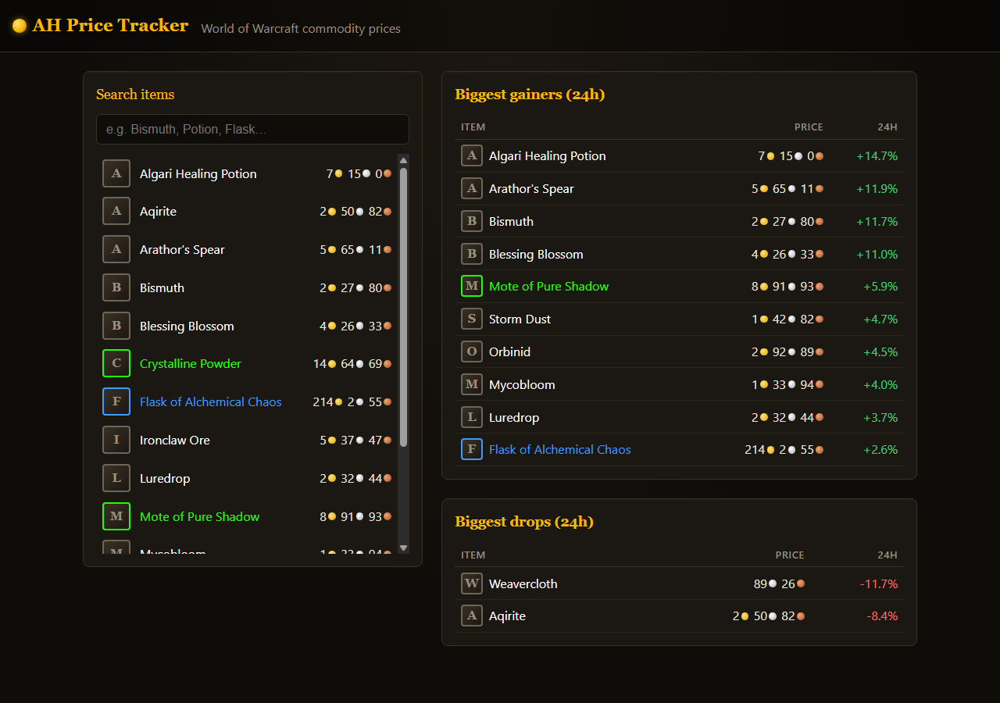
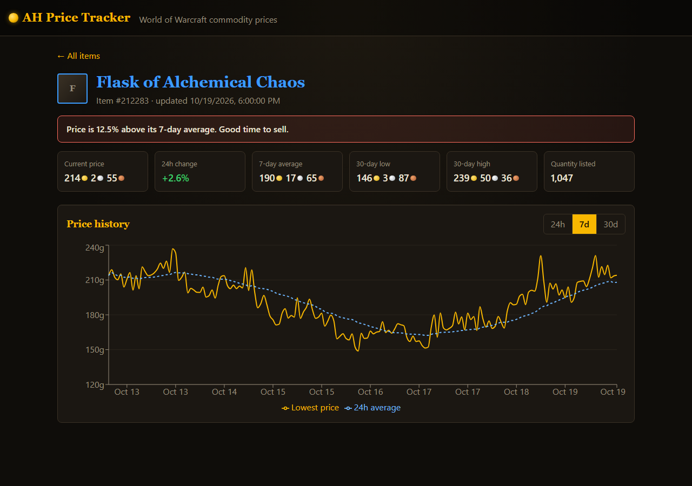
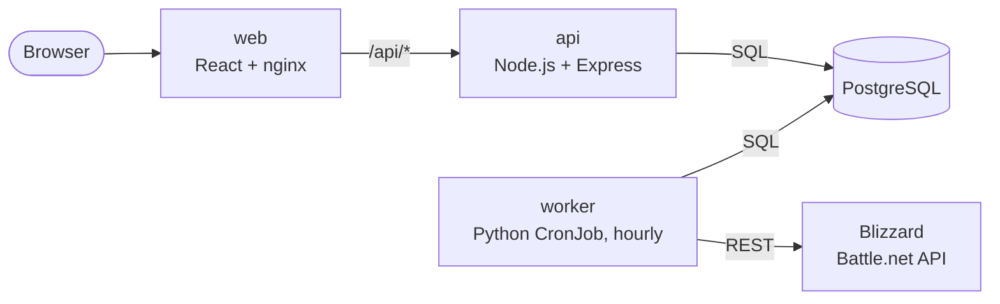

# AH Price Tracker

A full-stack web app that tracks **World of Warcraft Auction House prices** over time.

In-game, the Auction House only shows today's prices. This app saves a price snapshot every hour, so you can see how prices for herbs, ore, potions and other materials move over time and when it's a good time to buy or sell.




## Features

- **Search** every tracked item, with its current lowest price
- **Price history chart** (24h / 7d / 30d) with a 24-hour moving average
- **Stats:** current price, 24h change, 7-day average, 30-day low and high, quantity listed
- **Buy/sell signal** when the price is 10%+ below or above its 7-day average
- **Market movers:** the biggest 24-hour gainers and drops
- **Mock mode:** runs with realistic fake data, so no Blizzard API key is needed to try it

## Tech stack

| Technology | Where it's used |
|---|---|
| **TypeScript** | The frontend (`web/`) and the API (`api/`) |
| **React** | Frontend UI: pages, components, routing (`web/src/`) |
| **JavaScript** | TypeScript compiles to JS; `web/vite.config.js` is plain JS |
| **HTML / CSS** | `web/index.html`, `web/src/styles.css` |
| **Node.js** | Express REST API server (`api/`) |
| **REST APIs** | Builds one (`/api/items`, `/api/movers`, …) and calls one (Blizzard Battle.net API) |
| **Python** | Hourly data worker (`worker/`) |
| **SQL** | PostgreSQL schema plus queries using `LATERAL` joins, `DISTINCT ON`, window functions and CTEs (`api/src/repository.ts`) |
| **Docker** | A Dockerfile per service, plus `docker-compose.yml` for local dev |
| **Kubernetes** | Deployments, StatefulSet, CronJob, Services, Ingress, Secrets (`k8s/`) |
| **AWS** | ECR (image registry) + EC2 running k3s (see [docs/DEPLOY_AWS.md](docs/DEPLOY_AWS.md)) |
| **CI/CD** | GitHub Actions: test, integration test and build on every PR; deploy on merge (`.github/workflows/`) |
| **Git** | Feature branches + pull requests |
| **Agile** | User stories, sprints, GitHub Projects board (see [docs/AGILE.md](docs/AGILE.md)) |

## Architecture



1. Every hour, the **worker** downloads all commodity listings from Blizzard (often 100k+), condenses them into one row per item (lowest price, average price, quantity), and saves them to PostgreSQL.
2. The **API** answers questions about that data with SQL and returns JSON.
3. The **web** app (React) calls the API and draws the pages and charts. In production, nginx serves the built files and forwards `/api/*` to the API.

### Database

```
items           (id, name, quality, icon_url, metadata_updated_at)
price_snapshots (item_id, snapshot_time, min_price, avg_price, total_quantity)
```

Prices are stored in **copper** (1 gold = 100 silver = 10,000 copper), the same unit Blizzard uses. See [`api/sql/schema.sql`](api/sql/schema.sql).

## Running it locally

### Option A: Docker (easiest)

Requires [Docker Desktop](https://www.docker.com/products/docker-desktop/).

```bash
docker compose up --build
```

Open http://localhost:8080. The worker fills in 30 days of fake price history on its first run.
To take another snapshot: `docker compose run --rm worker`.
To start over with an empty database: `docker compose down -v`.

### Option B: without Docker

Requires Node.js 20+, Python 3.12+ and a local PostgreSQL with a `wow` user (password `wow`) and a `wow_ah` database.

```bash
# Terminal 1: API on http://localhost:3000 (creates the tables on startup)
cd api && npm install && npm run dev

# Terminal 2: load data
cd worker
python -m venv .venv
.venv/Scripts/activate          # macOS/Linux: source .venv/bin/activate
pip install -r requirements.txt
python -m ah_worker.main

# Terminal 3: frontend on http://localhost:5173
cd web && npm install && npm run dev
```

### Using real Blizzard data

1. Create a client at https://develop.battle.net/access/clients (free).
2. Copy `.env.example` to `.env` and fill in your client ID and secret (`MOCK_DATA=false`).
3. Run `docker compose down -v` to clear the mock data, then `docker compose up --build`.

Blizzard's API only gives the *current* listings, so price history builds up one snapshot per run. The first run also looks up names and icons for 100 new items at a time, so item names fill in over the first few runs.

## REST API

| Method & path | Description |
|---|---|
| `GET /health` | `{"status":"ok"}` if the API can reach the database |
| `GET /api/items?search=ore&limit=20` | Search items by name, with their latest price |
| `GET /api/items/:id` | One item: stats, 24h change and buy/sell signal |
| `GET /api/items/:id/prices?range=7d` | Hourly price history (`24h`, `7d`, `30d`) |
| `GET /api/movers?limit=10` | `{ gainers: [...], losers: [...] }` over the last 24h |

## Tests

```bash
cd api    && npm test     # signal logic + HTTP routes (fake database)
cd web    && npm test     # gold/silver/copper formatting
cd worker && pytest       # listing aggregation, mock data, Blizzard client
bash scripts/smoke-test.sh   # calls every endpoint of a running API
```

CI runs all of these on every pull request, plus an **integration test** that starts the real API and worker against a real PostgreSQL.

## Project structure

```
api/                    Node.js + TypeScript REST API
  sql/schema.sql          database tables (run automatically on startup)
  src/index.ts            starts the server
  src/app.ts              routes and input validation
  src/repository.ts       all SQL queries
  src/signal.ts           buy/sell signal logic
  test/                   unit tests (Vitest + Supertest)
web/                    React + TypeScript frontend (Vite)
  src/pages/              HomePage, ItemPage
  src/components/         SearchBox, MoversTable, PriceChart, Gold, ItemIcon
  src/api.ts              typed fetch calls to the API
  nginx.conf              production web server + /api proxy
worker/                 Python data worker
  ah_worker/main.py       entry point
  ah_worker/blizzard.py   Battle.net API client (OAuth)
  ah_worker/transform.py  listings -> one summary row per item
  ah_worker/mock.py       fake data generator
  ah_worker/db.py         inserts into PostgreSQL
k8s/                    Kubernetes manifests (kubectl apply -k k8s)
.github/workflows/      CI (ci.yml) and CD (deploy.yml)
docs/                   AWS deployment and Agile process
docker-compose.yml      whole stack locally
```

## Study guide

To learn the project from the inside out, read it in the order the data flows:

1. **Data model:** `api/sql/schema.sql`. What is stored, and why prices are in copper.
2. **Getting data:** `worker/ah_worker/main.py` → `blizzard.py` → `transform.py` → `db.py`. Then read `worker/tests/test_transform.py`.
3. **Serving data:** `api/src/index.ts` → `app.ts` (routes) → `repository.ts` (SQL). Run each query yourself in `psql`.
4. **Showing data:** `web/src/main.tsx` → `App.tsx` → `pages/` → `components/`.
5. **Containers:** each `Dockerfile`, then `docker-compose.yml`.
6. **CI/CD:** `.github/workflows/ci.yml`, then `deploy.yml`.
7. **Kubernetes:** `k8s/kustomization.yaml`, then each manifest.
8. **AWS:** `docs/DEPLOY_AWS.md`.

Good exercises: add a "watchlist" feature (new table, endpoint and page), add a `GET /api/items/:id/quantity` endpoint, or change the buy/sell threshold to come from an environment variable.
